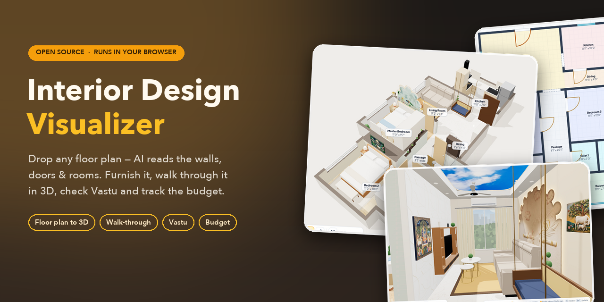
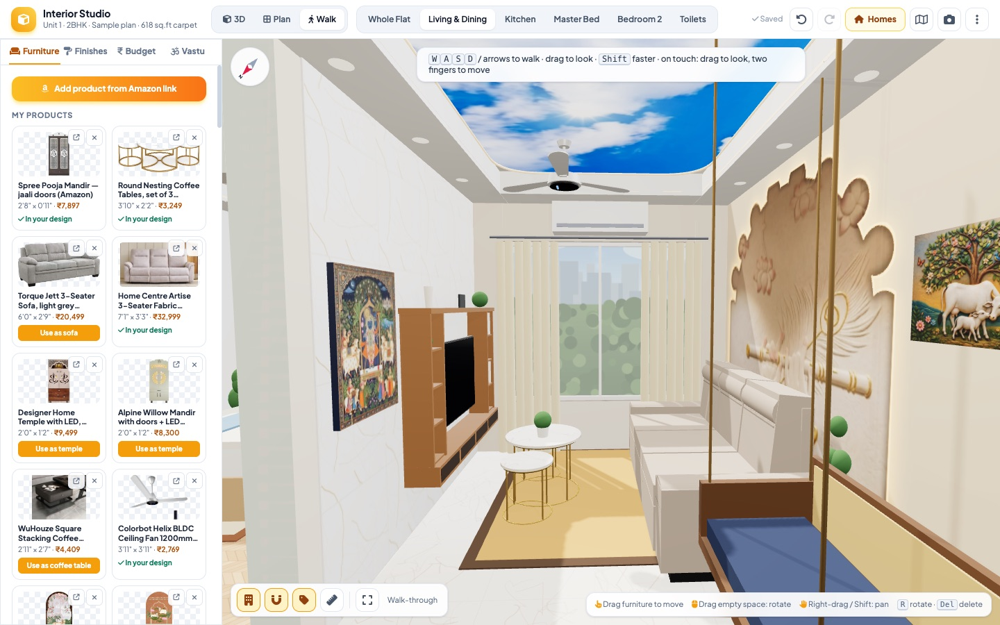
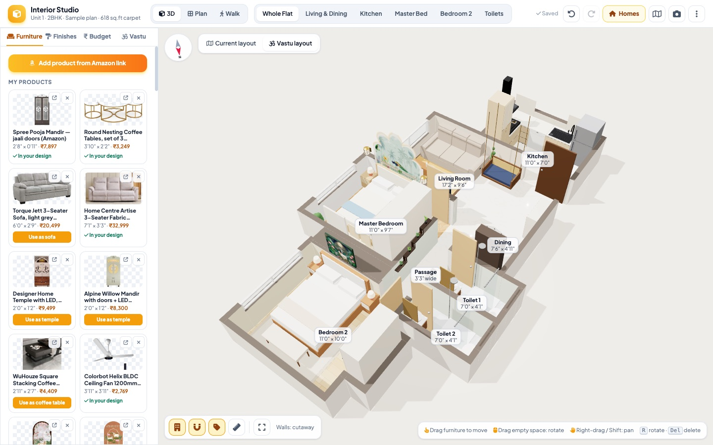
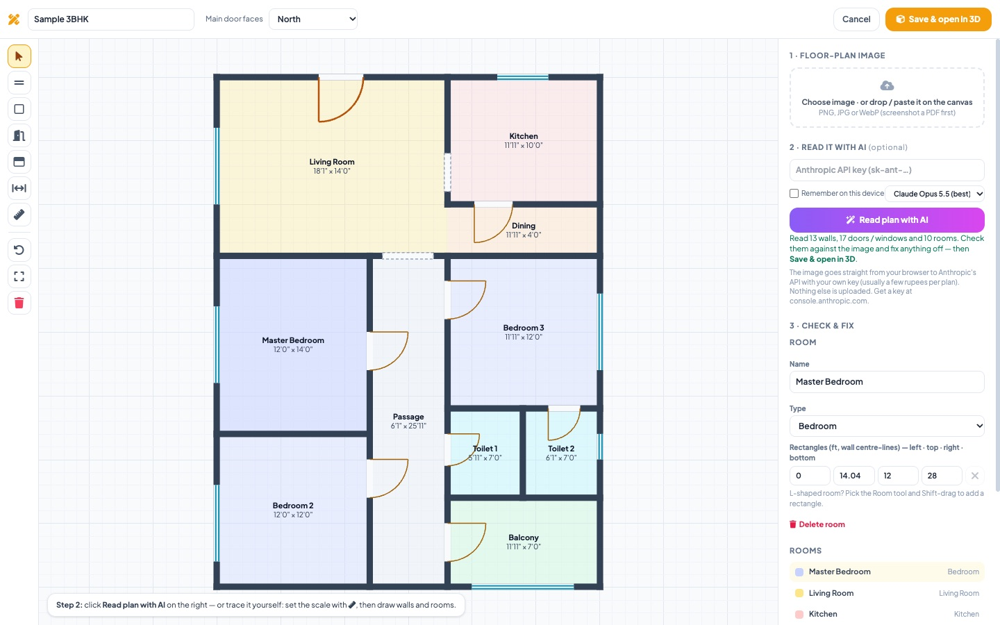
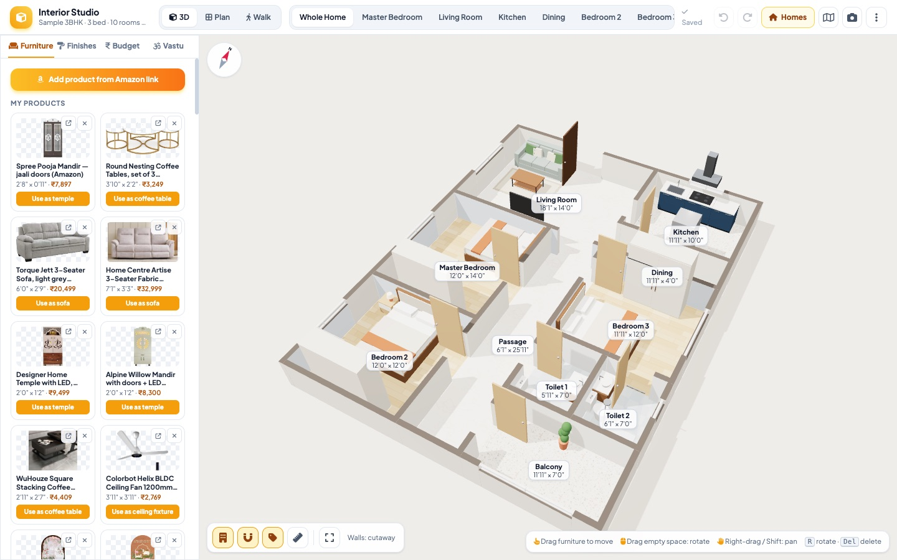
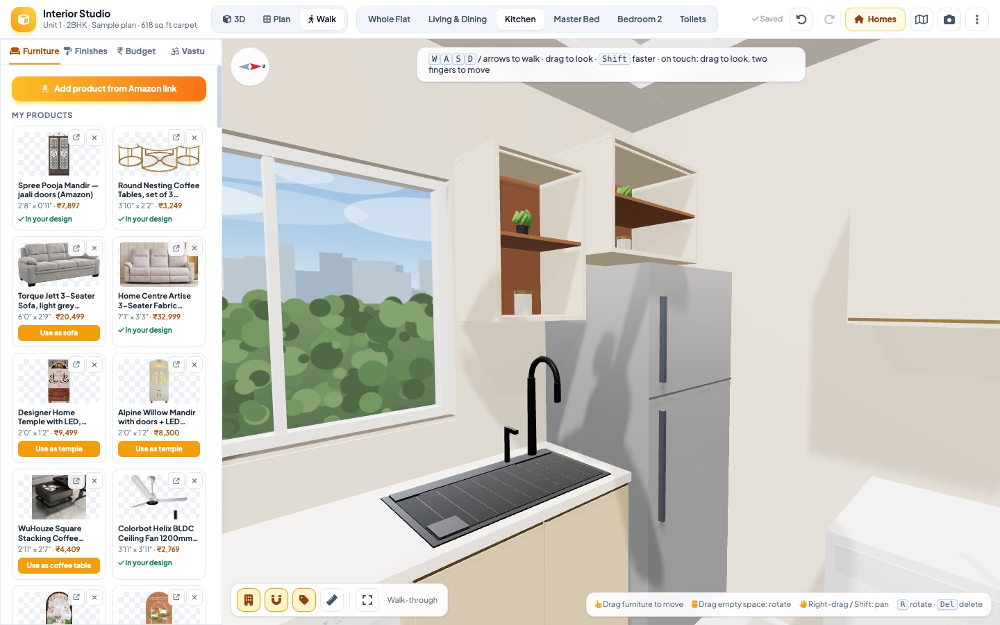
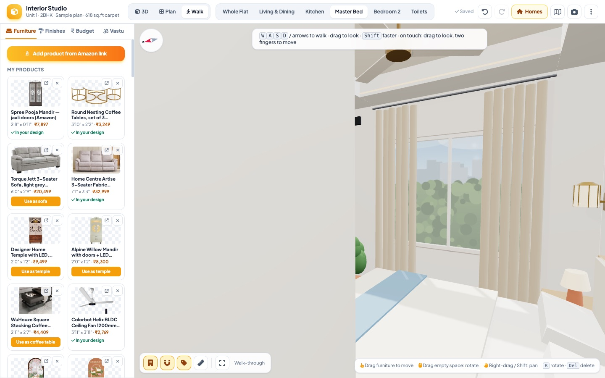
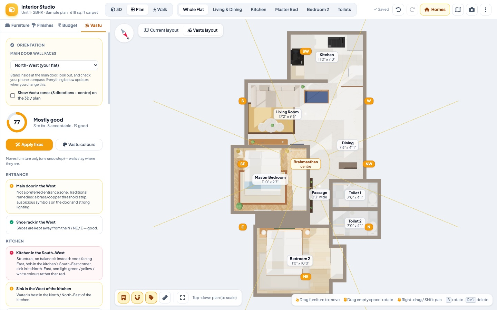
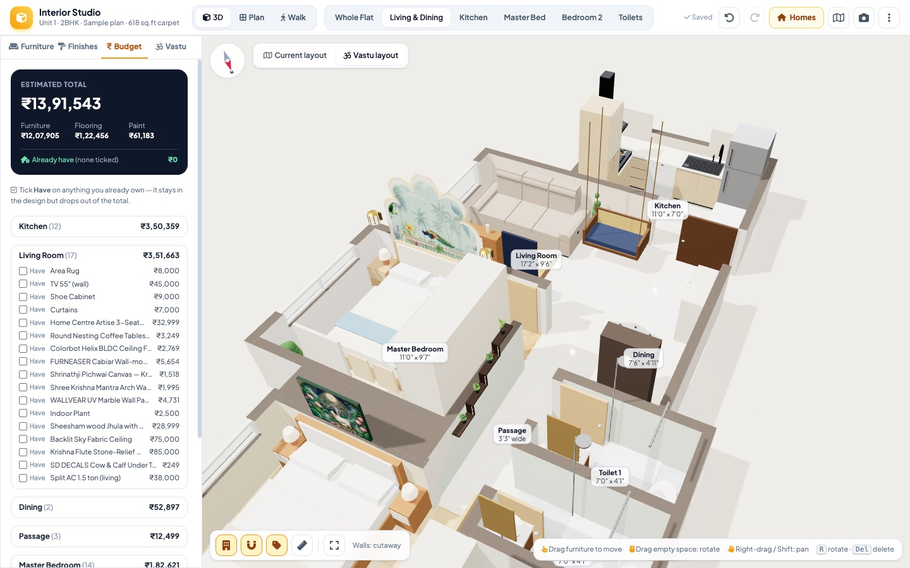

<p align="center"></p>

# Interior Design Visualizer

A single-file, in-browser **3D interior designer for any home or apartment**. Drop in your floor plan, then furnish, paint and walk through it in 3D. It checks the design against **Vastu** (optional) and keeps a running **budget / shopping list**.

**Live app:** http://myweoo.com/interior_design_visulizer/ (or download `interactive_interior_visualizer.html` and open it in Chrome — there's no build step and no server).

> **About the sample plan.** The built-in “Unit 1 · 2BHK · 618 sq.ft” home, and `samples/sample-2bhk-floor-plan.jpg`, use a **stock floor plan picked at random from the internet**. It's only a demo layout, not anyone's real address or property.

## Screenshots

| Walk through your home | Whole home in 3D |
|---|---|
|  |  |
| **Floor-plan editor (AI-read, then fix)** | **Your new home, auto-furnished** |
|  |  |
| **Kitchen** | **Bedroom** |
|  |  |
| **Vastu score & zone overlay** | **Budget & shopping list** |
|  |  |

---

## 1. Bring your own floor plan

1. Click **Homes**, then **New home from a floor-plan image**.
2. **Drop your plan image** onto the canvas. You can also choose a file or paste with Ctrl+V. PNG, JPG and WebP work; for a PDF, take a screenshot first.
3. **Read plan with AI** (optional, recommended). Paste your own [Anthropic API key](https://console.anthropic.com). Claude then reads the dimensions and returns the walls, doors, windows and rooms, and the result is laid over your image so you can compare.
   - The image goes straight from your browser to Anthropic using your key.
   - Each plan usually costs a few rupees.
   - Nothing else is uploaded anywhere.
4. **Check & fix** in the editor:

   | Tool | Key | What it does |
   |---|---|---|
   | Select | V | Click a wall, opening or room to edit exact sizes; drag a wall to slide it (rooms and joining walls follow); drag a door or window along its wall |
   | Wall | W | Click, click, … to draw straight walls; Esc, double-click or right-click stops |
   | Room | R | Drag over a room; Shift-drag adds a second rectangle to make an L-shape |
   | Door / Window / Opening | D / N / O | Click on a wall |
   | Scale | C | Click both ends of a known dimension and type its length (`11'6"`, `3.5 m`, `12`) — this is for tracing by hand without AI |

   Scroll to zoom, drag empty space to pan, F to fit, Ctrl+Z to undo.
5. Set **Main door faces** (the compass direction) for the Vastu checks. If the plan has a north arrow, the AI fills this in for you.
6. Click **Save & open in 3D**. The home gets starter furniture for each room type (sofa, TV and coffee table in the living room; beds, side tables and wardrobes in bedrooms; counters and fridge in the kitchen; WC and basin in toilets), which you can then change.

Every home keeps its own design, Vastu settings and budget. **Homes** lets you switch between them, edit a plan, export a `.home.json` to share or back up, import one, or delete one. To customise the sample flat, use **Edit this floor plan**, which makes your own copy.

## 2. Design it

- **3D / Plan / Walk** views. In Walk mode, use WASD and drag to look around.
- **Furniture tab:** drag items in from the catalogue, or add real products (see below). Every category has a fixed slot, so a new sofa replaces the old sofa in the same place.
- **Finishes tab:** wall paint and floor finish for each room, plus presets.
- **Vastu tab:** a live score with a checklist covering the entrance, kitchen fire and water, bed head direction, toilets, mandir, mirrors, sacred art, zone colours and the Brahmasthan. Click any line to jump to that item.
- **Budget tab:** everything priced per room, including flooring and paint. Tick **Have** for things you already own so they aren't counted. Export the list as a CSV.
- Export or import a design as `.json`, and save screenshots as PNG.

## 3. Update the design from a product name, Amazon link or Pinterest idea

### Inside the app (no AI needed)
Use **Furniture → Add product from Amazon**:
- Paste the product link and the product text (title, dimensions, price, colour). The app reads the size, price, colour and furniture type from them.
- Drop in the product photo. It's cut out from the background and used as the item's look in 3D.

### With Claude Code (recommended for Pinterest and “make it like this” ideas)
Open this folder in [Claude Code](https://claude.com/claude-code) and just type what you want, for example:

```text
add this sofa: https://www.amazon.in/dp/B0FCSKN27C
replace the chimney with "Whirlpool 60 cm curved glass chimney"
make my kitchen like this https://in.pinterest.com/pin/1126392556839617034/ (keep Vastu colours)
put this on the wall behind the sofa https://in.pinterest.com/pin/1125337025668569708/
I already have the fridge and washing machine — don't count them
```

Claude reads the link, image or name, sizes the product correctly, puts it in that category's slot, re-checks Vastu and clashes, and saves the change into the HTML file. `CLAUDE.md` contains the house rules it follows.

## How it works

- One self-contained HTML file using three.js r128, Tailwind (CDN) and Font Awesome. Product images are embedded as WebP data URIs. 1 unit = 1 foot.
- A floor plan is data: `rooms` (typed rectangles), `walls` (axis-aligned centre-lines with door, window and opening `ops`) and `blocks`. The built-in sample lives in `BUILTIN_PLAN`; your homes are stored in `localStorage` (`interior-studio-plan-<id>` and `interior-studio-design-<id>`).
- Prices are shown in ₹ (INR) and sizes in feet / inches; enter your own prices for any product.
- Everything stays in your browser. Clearing site data deletes your homes, so export them with **Homes → ⬇** to keep a backup.
